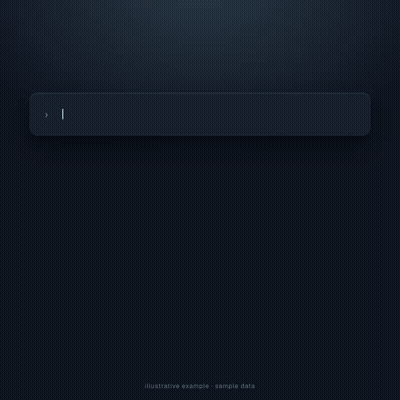

### Ivan Charczuk

**AI & Automation for Sales Teams** · Buenos Aires · ES/EN

I take a commercial process apart, find where the days go, and build the system or agent that gives them back.

<table>
  <tr>
    <td width="50%" align="center" valign="top">
      
       <b><a href="https://github.com/IvanCharczuk/spec-harness">spec-harness</a></b>
       The harness I use every day to work with coding agents one spec at a time. 140+ specs.
    </td>
    <td width="50%" align="center" valign="top">
      
       <b><a href="https://youtu.be/okWkX84BQI4">Saltar</a></b> · Twin track winner, HackaTwin
       Built in one day by a team of 4: peso credit for foreign companies, with an agent that reads invoices with Claude.
    </td>
  </tr>
</table>

**Work**

- **SMB Intern, TikTok Support LATAM** at Aleph (2026 – present): built the team's line-closing system from scratch, average close time from 7 to 2 days. Claude skills for reporting and sales decks.
- **Business Strategy Intern** at Edvolution, Madrid (2026): SaaS upsell analysis and a B2B loyalty framework.

**Also**

- [How I build skills](https://github.com/IvanCharczuk/skills/blob/main/how-i-build-skills.md): a short guide and a few skills ready to use.
- Digital Business at UCEMA (2027) · English C2 (Cambridge CPE)

**Stack**

**agents / ai** &nbsp;  
 **data** &nbsp;  
 **tools** &nbsp;   

[Portfolio](https://icharco.vercel.app) · [LinkedIn](https://linkedin.com/in/ivancharczuk) · [X](https://x.com/ivancharco)
